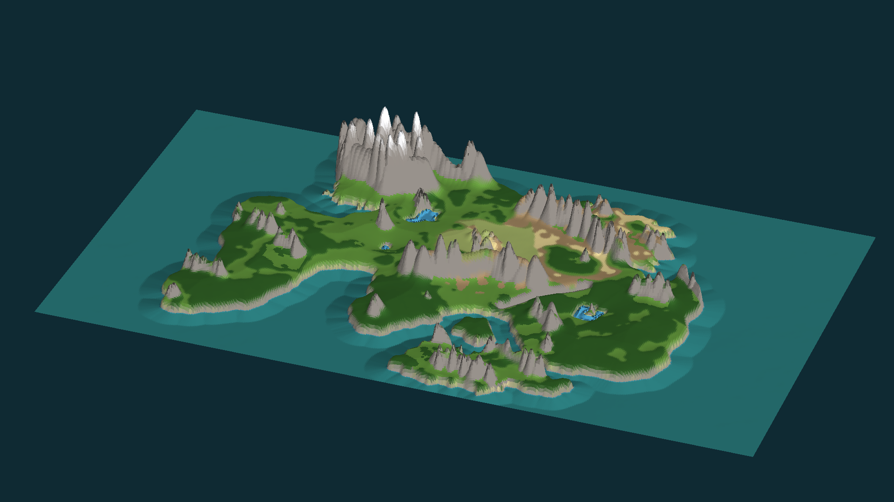

# Mapa sveta → Unreal Engine 5

Z nakreslenej mapy (`mapa/zdroj/mapa.jpg`) sa generuje 3D terén pre Unreal Engine 5.



## Čo je v repe

| Súbor | Na čo je |
|---|---|
| `mapa/unreal/heightmap.png` | **Heightmap** (16-bit, 2017 × 1135), z neho Unreal vytvorí terén |
| `mapa/unreal/vrstvy/trava.png` … | **Masky povrchu** (tráva, les, piesok, hlina, skala, sneh, dno), podľa nich sa terén zafarbí |
| `mapa/unreal/vrstvy/jazera_maska.png` | kde sú vnútrozemské jazerá (pomôcka na umiestnenie vody) |
| `mapa/nahlad/` | náhľady na kontrolu (zhora a v perspektíve) |
| `nastroje/generuj_mapu.py` | skript, ktorý všetko vygeneroval. Pohoria sú v ňom ručne zadané v zozname `RIDGES` |

## Návod: import do Unreal Engine 5

### 1. Projekt
1. Epic Games Launcher → Unreal Engine → **Launch**.
2. **Games → Third Person**, Blueprint, zaškrtni **Starter Content** → Create.
   Dostaneš postavu s ovládaním ako vo WoW (WASD, myš, medzerník).

### 2. Nový level
1. **File → New Level → Empty Open World** → Create. Ulož ho, napríklad ako `Svet`.
2. V **Edit → Project Settings → Maps & Modes** nastav **Editor Startup Map** a **Game Default Map** na `Svet`.

### 3. Materiál terénu (aby sa dali použiť masky)
1. V Content Browseri: pravý klik → **Material**, pomenuj ho `M_Teren` a otvor ho.
2. Pravý klik do grafu → **Landscape Layer Blend**. V detailoch pridaj 7 vrstiev s **presne** týmito názvami:
   `trava`, `les`, `piesok`, `hlina`, `skala`, `sneh`, `dno` (Blend Type: *LB Weight Blend*).
3. Do každej vrstvy zapoj **Texture Sample** s textúrou zo Starter Content (Ground_Grass, Rock, Sand…)
   alebo z Fab/Megascans. Pred textúry daj **LandscapeLayerCoords** (Mapping Scale ~ 4), aby sa neopakovali príliš nahusto.
4. Výstup Layer Blend zapoj do **Base Color** → Save.

### 4. Vytvorenie terénu
1. Prepni sa do **Landscape** módu (Shift+2) → **Manage → New**.
2. **Import from File**, vyber `mapa/unreal/heightmap.png`.
3. **Material**: `M_Teren`. V zozname vrstiev klikni pri každej na **+** → *Weight-Blended Layer* (vytvorí sa Layer Info)
   a pri každej vrstve vyber jej súbor z `mapa/unreal/vrstvy/` (napr. `trava` → `trava.png`).
4. Nastavenia:
   - **Section Size:** 63×63 Quads, **Sections Per Component:** 1×1
   - **Number of Components:** 32 × 18 (výsledok **2017 × 1135**)
   - **Location:** 0, 0, 0
   - **Scale:** X **200**, Y **200**, Z **100**, takže svet má cca **4 × 2,3 km** a hory ~200 m.
5. **Import**. Terén s horami, pobrežím a farbami je hotový.

> Chceš väčší svet? Daj Scale X/Y = 400 a Z = 200 (svet má potom 8 × 4,5 km).

### 5. More
- Hladina mora je v heightmape na úrovni **Z = −1024** (pri Z scale 100).
- Najjednoduchšie: pridaj obrovský **Plane** (Scale 500×500), daj mu materiál `M_Water_Ocean`
  zo Starter Content a umiestni ho na Z = **−1024**.
- Krajšie: zapni plugin **Water** (Edit → Plugins), reštartuj editor a použi **Water Body Ocean** a **Water Body Lake**
  (jazerá máš v `jazera_maska.png`).

### 6. Hráč
1. Do levelu pridaj **Player Start** (Quick Add → Basic → Player Start) a polož ho na pevninu, napríklad do zelených plání v strede mapy.
2. Stlač **Play**. Behaš po svojej mape. 🎉

### 7. Stromy a tráva
- **Foliage** mód (Shift+3): pretiahni sem modely stromov (Fab má zadarmo celé balíky) a maľuj ich štetcom na lesy.
- Tráva automaticky: v `M_Teren` pridaj **Landscape Grass Output** napojený na vrstvu `trava`.

## Úprava hôr

Pohoria nie sú rozpoznané z farieb, sú zadané ručne v `nastroje/generuj_mapu.py` v zozname `RIDGES`
(súradnice v pixeloch pôvodného obrázka 2000 × 1125, polomer, výška 0–1). Uprav ich a spusti:

```bash
pip install -r nastroje/requirements.txt
python3 nastroje/generuj_mapu.py
python3 nastroje/nahlad_3d.py
```
